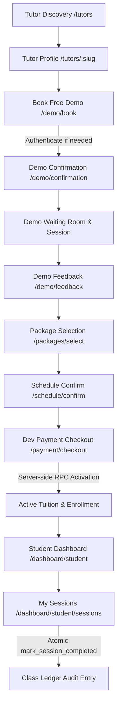

# TutorConnect — Personalized 1-on-1 Tuition Platform

TutorConnect connects school students (Classes 6–12) with verified educators in Hyderabad for 1-on-1 online learning and localized in-home tuition. Built with **Next.js 16 (Turbopack)**, **Tailwind CSS v4**, and **Supabase (PostgreSQL + RLS)** under the **Sunlit Grove** visual design identity.

---

## 1. Quick Start

```bash
# 1. Install dependencies
npm install

# 2. Configure environment variables
cp .env.example .env.local

# 3. Start local development server
npm run dev
```

The app runs on [http://localhost:3000](http://localhost:3000).

---

## 2. Environment Variables Contract

Copy `.env.example` to `.env.local`. Never commit secret keys or `.env.local`.

```env
# Supabase API Configuration (Public)
NEXT_PUBLIC_SUPABASE_URL=https://your-project.supabase.co
NEXT_PUBLIC_SUPABASE_PUBLISHABLE_KEY=your-publishable-key

# Demo / Development Flags
TUTORCONNECT_DEMO_PAYMENT_MODE=true
```

---

## 3. Architecture & Tech Stack

- **Framework:** Next.js 16 (App Router, Server Actions, Server Components)
- **Styling:** Tailwind CSS v4 with custom Sunlit Grove design tokens (`amber-warm`, `emerald-deep`, `parchment`, `paper-light`)
- **Backend & Database:** Supabase (PostgreSQL 15+, Row Level Security, SSR cookie handling)
- **Authentication:** Supabase SSR with verified claims via `auth.getClaims()` and POST-only sign-out
- **Deployment Target:** Vercel Hobby / Free Tier + Supabase Free Tier (zero paid dependencies)

---

## 4. Database Migrations History

All schema changes are tracked via forward-only migrations under `supabase/migrations/`:

1. `20261003062937_phase2_backend_foundation.sql` — Core user profiles, role mapping (`parent`, `student`, `tutor`, `admin`), learner profiles, tutor profiles, application states, subjects, and atomic onboarding RPC.
2. `20261003063051_harden_security_definer_functions.sql` — Security definer hardening, moving helper functions to `private` schema with explicit search paths.
3. `20261003071008_phase2_runtime_alignment.sql` — Indexing on application states and RLS query performance alignment.
4. `20261003071059_phase2_policy_cleanup.sql` — Clean separation of anon and authenticated SELECT policies on approved tutor profiles and subjects.
5. `20261003073000_phase3_core_workflow.sql` — Phase 3 entities: `public_tutor_catalog`, `demo_bookings`, `demo_feedback`, `tuition_packages`, `package_purchases`, `student_tutor_enrollments`, `class_sessions`, `class_ledger_entries`, and secure transactional RPCs.

---

## 5. Phase 3 Entities & Database Concepts

### 1. `public_tutor_catalog`
Dedicated public discovery catalogue containing approved educator profiles, bio, subjects, boards, locality, delivery modes (`offers_online`, `offers_home`), ratings, and demo capacity. Enables seamless browsing without injecting fake auth users.

### 2. `demo_bookings`
Free 30-minute introductory sessions between a learner (`student_profile`) and an approved tutor:
- **Mode:** Always online.
- **Duration:** Strictly 30 minutes.
- **Price:** Strictly ₹0 (no payment info stored).
- **Statuses:** `requested`, `confirmed`, `completed`, `cancelled`, `no_show`.
- **RLS:** Account owners access only bookings belonging to their owned student profiles. Tutors access only bookings assigned to them.

### 3. `demo_feedback`
Family post-demo feedback:
- Ratings (1–5 stars), qualitative feedback, and tuition interest flag.
- Strictly private: Accessible only to booking owners and admin.

### 4. `tuition_packages`
One-time class packages (NOT subscriptions, no auto-renew):
- **8 Classes:** ₹3,200 (60 mins/class, 45-day validity)
- **12 Classes:** ₹4,500 (60 mins/class, 45-day validity, highlighted as Balanced Choice)
- **15 Classes:** ₹5,400 (60 mins/class, 45-day validity)
- Total classes defined at package level without permanent rigid subject locks.

### 5. `package_purchases`
Purchase records with audit statuses: `pending`, `activated`, `failed`, `cancelled`, `refunded`.
- URL query parameters (e.g. `?status=success`) cannot activate purchases.
- Development activation is executed server-side via the `simulate_purchase_activation` RPC.

### 6. `student_tutor_enrollments`
Active tuition relationship binding student profile, tutor, and package purchase:
- Tracks `total_classes`, `remaining_classes`, `started_at`, `valid_until` (activation + 45 days), and status (`active`, `completed`, `expired`, `cancelled`).

### 7. `class_sessions`
Canonical lesson schedule records:
- **Modes:** `online` or `home`.
- **Statuses:** `scheduled`, `in_progress`, `completed`, `cancelled`, `student_no_show`, `tutor_no_show`.
- **Session Mode Boundary Rule:** Online sessions show a disabled demo 'Join Class' button. Home sessions **NEVER** render a 'Join Class' button and only display general meeting/locality information.

### 8. `class_ledger_entries`
Append-only durable audit ledger tracking balance consumption:
- Transactional `mark_session_completed(p_session_id)` RPC verifies caller authorization, prevents double completion via unique constraint `idx_ledger_session_completed`, writes ledger entry (`class_completed`), and decrements `remaining_classes` by 1 in a single atomic transaction.
- Balance cannot become negative (`CHECK remaining_classes >= 0`).

---

## 6. Target Journey & Lifecycles



---

## 7. Demo Implementation vs. Production Requirements

| Area | Phase 3 Demo / Development Implementation | Production Target (Phase 4+) |
| :--- | :--- | :--- |
| **Payments** | Server-side simulated RPC activation gated by `TUTORCONNECT_DEMO_PAYMENT_MODE=true`. No real money. | Razorpay/Cashfree order creation, hosted checkout, server-side webhook signature verification, idempotency audit, refunds & tutor payouts. |
| **Video Rooms** | Accessible placeholder demo-room state with disabled button and clear explanation. | Live WebRTC video integration via Daily.co or LiveKit Cloud with secure ephemeral room tokens. |
| **Locations & Mapping** | Locality strings (e.g. Madhapur, Gachibowli) and conservative disclaimer ('Home tuition availability confirmed during scheduling'). | PostGIS geographic point coordinates, geocoding API, and real Euclidean/travel distance radius filtering. |
| **Notifications** | Supabase free built-in auth emails (rate-limited). No product-critical SMS or WhatsApp. | Dedicated transactional email (Resend/SendGrid) + WhatsApp/SMS notification gateway (Twilio/Gupshup). |
| **Tutor Catalogue** | `public_tutor_catalog` table seeded with verified educator profiles. | Dynamic onboarding and verification pipeline with document KYC, background checks, and automated review. |

---

## 8. Quality & Verification Commands

```bash
# 1. Phase 3 Workflow & Business-Rule Test Matrix
node scripts/test_phase3_workflow.js

# 2. Static Security & Redirection Tests
node scripts/test_security_static.js

# 3. Live Supabase RLS Policy Tests
node scripts/test_live_rls.js

# 4. Authenticated Proof Test
node scripts/test_authenticated_proof.js

# 5. Zero-Warning Lint Audit
npm run lint -- --max-warnings=0

# 6. Production Next.js Build
npm run build
```
